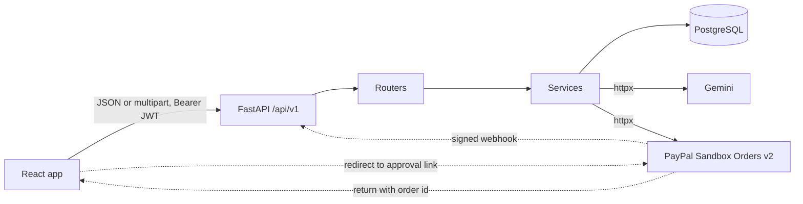

# Subwise

**Track every subscription. Never miss a price hike again.**

Subwise is a subscription-intelligence web app. You add or import your recurring payments, see what you really spend per month and per year, get warned about renewals and price changes, and (on the Plus plan) ask an AI analyst questions that are answered **only from your own saved records**.

Built for the PayPal hackathon on Devpost. It uses the **PayPal developer platform (Sandbox)** for the Plus plan and **Google Gemini** as its AI tool.

- Live demo: `<DEMO_URL>`
- Demo account and PayPal Sandbox test buyer: given in the Devpost submission (never stored in this repository)
- License: MIT

> Subwise is a tracker, not a bank or a canceller. It does **not** cancel subscriptions, connect to Netflix, Spotify or other providers, link bank accounts, read your PayPal history, or convert currencies.

---

## What works today

| Area | Status |
|---|---|
| Register, sign in, sign out, automatic session refresh | Working |
| Subscriptions: add, edit, search, filter, sort, paginate, change status, archive | Working |
| Duplicate warning and Free-plan limit (5 subscriptions) | Working |
| Dashboard: monthly and yearly spend per currency, upcoming renewals, spend by category, price changes | Working |
| Plus plan through PayPal Sandbox (create order, approve, server-side capture) | Working, verified with a real sandbox payment |
| AI analyst (Plus): one question at a time, answers cite your subscriptions | Working |
| Import from CSV (local pattern detection, no AI) with review, edit, confirm and undo | Working |
| Import from pasted email (redacted, then read by AI) | Working |
| Light and dark themes, mobile layout | Working |
| 201 automated backend tests | Passing at the last full run |

## Built but not fully verified

- **PDF and image import.** The code path and its tests (with the AI mocked) pass, but it has not been tried end to end with real files.
- **PayPal webhook.** Signature verification, idempotency and refund or denied-payment handling are implemented and tested with simulated events. It can only be tested live once the app has a public URL.
- **Notifications.** The backend creates in-app alerts (renewals at 1, 3 and 7 days, trials ending, price increases) and exposes an API for them. **There is no notifications screen yet**: the Notifications page in the app is a placeholder.

## Not built

These are deliberately out of scope for the hackathon and should not be assumed to exist:

- Email of any kind: no renewal emails, no weekly digest, no password-reset emails (a reset token is only logged in development)
- Forgot-password, change-password, edit-profile and delete-account screens (the backend endpoints exist, the screens do not)
- Subscription detail page with a price-history timeline (price changes appear on the dashboard only)
- Screens for managing categories, tags and bulk actions (the API supports them)
- Saved CSV column-mapping screens (the API supports them)
- Budgets, savings tracker, health score, spending forecast, calendar export
- AI conversation history, AI-proposed actions, AI reports
- Quarterly billing detection in imports (quarterly can still be entered by hand)
- Database migrations (tables are created with a script) and AI request retries
- Real payments: PayPal is **Sandbox only**, so no real money ever moves
- **Notifications are not usable in the app.** The backend can generate in-app alerts and serve them over the API, and that code is tested, but there is no notifications screen yet. The Notifications page in the app is a placeholder.

---

## How PayPal is used

Plus costs the price stored on the server (see `GET /api/v1/plans`) and is paid for through the **PayPal Orders v2 REST API** using the redirect flow:

1. `POST /payments/create-order`: the client only names the plan. The **server** reads the price from the database, creates the PayPal order with an idempotency key and returns the PayPal approval link.
2. The browser goes to PayPal Sandbox and the buyer approves the payment.
3. PayPal returns the buyer to the app with the order id. The app calls `POST /payments/capture-order`.
4. The server captures the order, checks the status, currency and amount, marks it completed and activates Plus for the plan's duration. Approving alone unlocks nothing.
5. `POST /payments/webhook` verifies PayPal's signature on the raw body and stores each event id once. A completed capture unlocks Plus if the browser never returned, and a refund, reversal or denial revokes it.

Everything runs against `https://api-m.sandbox.paypal.com`. The app never sees card details, and no secret is ever sent to the browser.

## How AI is used

AI is **Google Gemini**, called from the server only (`app/services/ai_client.py`). The model is set with `AI_MODEL`.

- **AI analyst** (`POST /ai/ask`): the server builds a context from the signed-in user's own non-archived subscriptions (name, amount, currency, billing interval, status, renewal date, category, trial end, recent price changes, per-currency totals). It never includes notes or other users' data. The answer must cite records (S1, S2, ...), and citations are checked against the real list. The AI has no way to write data.
- **Import extraction**: Gemini reads PDFs, images and pasted emails and proposes subscriptions. Every proposal goes to a review screen and **nothing is saved until the user confirms it**. The output is validated before it is stored.
- **CSV import uses no AI.** It is detected locally by fixed rules.

## Privacy

- **CSV files** are read by Subwise itself and are not sent to any AI service.
- **PDFs and images** are sent to Google Gemini **as they are, unredacted**, because binary files cannot be redacted. Only upload files you are comfortable sharing. The app asks you to acknowledge this before upload.
- **Pasted emails** are automatically redacted, then sent to Gemini. Redaction is automatic and imperfect.
- **AI questions** send the subscription facts listed above.
- If you use the Gemini free tier, Google's terms may allow it to use submitted content to improve its products. Check Google's current terms before using real data.
- Uploaded files are stored on the server's local disk.

---

## Architecture



Routers are thin. Services hold the rules and check ownership. Outside calls happen only in `ai_client.py` and `paypal_client.py`, which the tests replace, so no test reaches a real provider. Every query is filtered by user, and another user's record returns the same 404 as a missing one.

Other rules the app keeps: totals are **per currency and never summed across currencies**, price history is append-only, and a shared subscription counts only your share.

## Tech stack

Python 3.13, FastAPI, SQLAlchemy 2, PostgreSQL, Pydantic v2, JWT with rotating refresh tokens, bcrypt, httpx, pytest. Frontend: React, Vite, React Router, Lucide icons, plain CSS (Instrument Serif, Geist and Geist Mono). AI: Google Gemini. Payments: PayPal Sandbox.

## Run it locally

You need Python 3.13, Node.js (LTS) and PostgreSQL.

```powershell
# 1. Backend
python -m venv .venv
.venv\Scripts\Activate.ps1
pip install -r requirements.txt
copy .env.example .env        # then fill in your own values
python -m app.create_tables
python -m app.seed
uvicorn app.main:app --reload # http://localhost:8000/docs

# 2. Frontend (second terminal)
cd frontend
npm install
npm run dev                   # http://localhost:5173
```

For local PayPal testing, set these in `.env` so PayPal returns to the Vite app, then restart the backend:

```
PAYPAL_RETURN_URL=http://localhost:5173/?paypal=return
PAYPAL_CANCEL_URL=http://localhost:5173/?paypal=cancel
```

**Production build:** `cd frontend && npm run build`. If `frontend/dist` exists, FastAPI serves it at `/`, with the API under `/api/v1`.

**Environment variables** (see `.env.example`; never commit `.env`): `DATABASE_URL` (must start with `postgresql+psycopg2://`), `TEST_DATABASE_URL` (its name must contain `test`), `SECRET_KEY`, `AI_API_KEY`, `AI_MODEL`, `PAYPAL_CLIENT_ID`, `PAYPAL_CLIENT_SECRET`, `PAYPAL_BASE_URL`, `PAYPAL_WEBHOOK_ID`, `PAYPAL_RETURN_URL`, `PAYPAL_CANCEL_URL`.

**Tests:**

```powershell
pytest -q
```

The suite refuses to run against any database whose name does not contain `test`.

## Known limitations

- PayPal runs in Sandbox only. To pay, use a Sandbox personal buyer account, not a real PayPal login.
- Free hosting sleeps when idle, so the first request after a pause can take about a minute.
- Uploaded files live on local disk and may be wiped when the host redeploys.
- Rate limits are kept in memory per server process.
- The Plus price and 30-day duration are demo values.

## License

MIT. See [LICENSE](LICENSE).